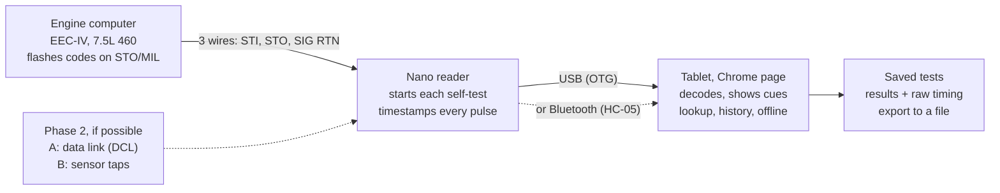

# Plan: Android tablet web app (and live data, if possible)

Planning document, not yet built. Scoped 2026-11-14. Updated after checking the project against Probst, *Ford Fuel Injection & Electronic Engine Control, 1988–1993*, and the 1994 7.5L pickup wiring diagram ([pinout-1994-7.5L.md](pinout-1994-7.5L.md)).

## Summary

The plan is a single web page that runs in Chrome on an Android tablet and reads the EEC-IV self-test codes of the 1994 E-350 motorhome (7.5L 460). It talks to the same Arduino Nano reader as the laptop version, over USB or Bluetooth. Live data comes later, and only if a check on the motorhome shows it can be done.

- **Phase 1 (committed):** codes on the tablet. That covers the key-on and memory codes, the engine-running test with big on-screen and audible prompts, erasing codes, the wiggle test, a code lookup and a saved history.
- **Phase 2 (gated):** live data. The 1994 7.5L pickup diagram shows the computer's data link wired to the self-test connector, so **Gate 1 probably passes**: the computer's own data link is the likely route. Still to confirm on the van, and the data link's message format still has to be learned. Tapping sensor signals directly stays as the fallback.
- **Why a web page:** Chrome for Android added the Web Serial API in version 148 ([Notebookcheck](https://www.notebookcheck.net/Chrome-148-Beta-for-Android-adds-Web-Serial-SharedWorker-support.1269721.0.html)), so a page can talk to the Nano with no app to install. The same page also works on a Windows laptop in Chrome or Edge.

## What carries over and what changes

| Part | Phase 1 |
| --- | --- |
| Nano reader circuit (2 optocouplers, diode, resistors) | Unchanged |
| Nano sketch (`arduino/eec_bridge`) | Unchanged for USB; small addition for Bluetooth |
| Pulse decoder and timing limits (`pc/eec_protocol.py`) | Ported to JavaScript, same rules |
| Live running-test prompts (`LiveKoer`) | Ported, including the early heads-up and the no-engine-ID case |
| Code table (`pc/ford_codes.py`) | Ported to the page |
| Simulated motorhome (DEMO mode) | Ported, so the page can be tried with no hardware |
| Decoder tests (`tests/`) | Ported, run against the same simulated pulse trains |
| Python scanner (`pc/eec_scan.py`) | Kept for laptop use |
| Docs and agent guides | Updated for the tablet |

## Architecture

The Nano stays simple: it grounds the test input on command and reports each pulse with a timestamp. All the decoding, cues and storage happen in the page.

- **Link:** USB through an OTG adapter, or Bluetooth through an HC-05 module. Chrome on Android reaches both through Web Serial, including classic Bluetooth serial ([Chromium](https://groups.google.com/a/chromium.org/g/blink-dev/c/BqUGCcurReE)).
- **Page:** one self-contained HTML file with no server behind it. Web Serial needs an https address, so it would be hosted on a free static host such as GitHub Pages, from this repo.
- **Offline:** the page installs to the tablet's home screen and caches itself, so it works at a campsite with no signal.
- **Storage:** test history stays on the tablet in the browser's storage, with export to a file for backup or sharing. Nothing is sent anywhere.

## Phase 1 features: codes on the tablet

Phase 1 does everything the laptop scanner does, laid out for a tablet held in the driver's seat.

- **Connect screen:** one button to pick the Nano (USB or Bluetooth), a status light, and a DEMO button that runs the simulated motorhome.
- **Key-on test:** a setup checklist (engine warm, Park, loads off, key off 10 s), a big "Turn the key ON now" cue, a live pulse view, then results split into "present now" and "memory codes".
- **Engine-running test:** a warm-up checklist (2000–2500 rpm for 2–3 minutes), then full-screen cues with a sound and vibration. A heads-up comes as the engine ID starts, then NOW within a second of its end for the wheel, brake and O/D steps; the book gives a 1–2 second window. A separate cue comes for the throttle snap. This is the main reason a tablet beats the laptop.
- **Erase memory codes:** behind a confirmation that shows the last saved memory codes first.
- **Wiggle test,** key on and engine running: a large FAULT flash and beep each time the line goes active, with a running timestamp list.
- **Code lookup:** type a code, get the plain-English meaning, plus a note when it's usually a missed test step.
- **History:** every test saved with date, results and raw pulse timing. Each can be exported, or re-decoded with adjusted timing limits.
- **Settings:** timing limits, sound and vibration on or off, keep the screen awake during tests.
- **Possible addition from the book:** the Output State test (Probst p. 228), where the computer switches all its actuators on and off on command, for checking solenoids and relays.

## Phase 2: live data, if it turns out to be possible

The 1994 7.5L pickup wiring diagram shows a data pair from the computer (pin 9, pink/light blue, circuit 915, and pin 28, tan/orange, circuit 914) running to the self-test connector, which it calls the Data Link Connector ([pinout-1994-7.5L.md](pinout-1994-7.5L.md)). So the van very likely has the data link, and Path A is the main route. What's still unknown is the message format. There are three paths, tried in this order.

| Path | What it gives | Depends on | Effort | Runs on the tablet |
| --- | --- | --- | --- | --- |
| A. The computer's data link (DCL) | The computer's own values: rpm, temperatures, throttle, O2, possibly fuel trim and timing | The tan/orange and pink/light blue wires in the test connector (shown on the 1994 7.5L pickup), and learning the message format | High: the protocol is not published | Yes |
| B. Tap the sensor signals directly | Raw sensor readings: coolant and air temp, throttle, O2, MAP, rpm, speed, injector on-time | Reaching the wires, usually at the computer's 60-pin connector | Medium: a small add-on board | Yes |
| C. J3 service port logger (commercial) | Anything in the computer's memory, fast | Buying a Moates QuarterHorse plus software support for this computer | Low to build; costs money; laptop software | No |

**Path A, the data link.** Ford scan tools of the era read live data from 1990+ EEC-IV vehicles over the data communications link (DCL) ([Actron manual](https://laundry.manualsonline.com/manuals/mfg/actron/9640a.html?p=75)). Not every EEC-IV supports it. It needs the data wires in the test connector (said to be cavities 1 and 3) and the matching hardware in the computer ([ford-trucks.com](https://www.ford-trucks.com/forums/1803656-ect-question-3.html)). The 1994 7.5L pickup has both wires running to the computer's pins 9 and 28, which points to the hardware being there too. Probst names the DCL, shows Ford's NGS tester using a 5-pin STAR/DCL adapter, and lists the DCL fault codes 529 and 533. He gives no protocol. The practical route is still to borrow or buy a used DCL-capable scan tool, connect it, and record its traffic with the Nano to learn the messages. A 529 or 533 memory code would hint that this vehicle uses the link.

**Path B, sensor taps.** This works no matter what the computer supports. A small board of voltage dividers and input protection feeds the Nano's inputs from the sensor wires, tapped in parallel without cutting anything. The 1994 7.5L pinout ([pinout-1994-7.5L.md](pinout-1994-7.5L.md)) lists every sensor wire by pin and color; Probst's pinout (p. 137) and sensor signal ranges (p. 217) give the starting list. For example, the computer flags the coolant sensor when its signal leaves 4–91% of the 5 V reference. This reads what the sensors say, but not values the computer calculates (fuel trim, spark advance). Others have landed on the same fallback ([ford-trucks.com](https://www.ford-trucks.com/forums/1036028-tuning-our-ford-obdi-eec-iv-qh-tweecer-others-2.html)).

**Path C, the J3 port.** The QuarterHorse plugs into the computer's service port and can log any value in memory at over 20 samples a second ([Moates](https://moates.net/datalog-and-reflash-c-97.html)). It only works if software support exists for this specific computer, which isn't guaranteed ([Moates support](https://support.moates.net/tag/qh1/feed)). It's listed so the choice is complete.

**Decision gates:**

1. **Gate 1, look at the test connector: probably passes.** The 1994 7.5L pickup diagram shows the data pair wired. On the van, confirm a tan/orange and a pink/light blue wire in the 6-cavity connector. If both are there, go to Gate 2. If the van turns out not to have them, skip to Path B.
2. **Gate 2, does the computer answer?** If a DCL-capable scan tool shows live data on this motorhome, record and decode its traffic (Path A). If not, go to Path B.
3. **Gate 3, is Path B worth it?** Only if the Phase 1 codes haven't found the problem and a sensor reading would settle it.

## Hardware and parts additions

These are on top of the existing parts list. Phase 1 needs one of the two link options. Phase 2 parts are bought only after the matching gate passes.

| Item | For | Notes |
| --- | --- | --- |
| USB-C OTG adapter (USB-C male to USB-A female), or a USB-C to USB-C cable | Phase 1, USB link | The tablet powers the Nano |
| HC-05 Bluetooth module (classic Bluetooth, not BLE) | Phase 1, Bluetooth link | Chrome on Android uses classic Bluetooth serial, so a BLE-only module such as the HM-10 won't work |
| 1 kΩ and 2 kΩ resistors | Phase 1, Bluetooth link | Drops the Nano's 5 V transmit line to the 3.3 V the HC-05 expects |
| USB power for the Nano (dash 12 V USB adapter or a power bank) | Phase 1, Bluetooth link | With Bluetooth the tablet no longer powers the Nano |
| Used DCL-capable scan tool (Actron, Equus or similar from the era) | Phase 2, Path A | To confirm the computer sends live data, and to record its messages |
| Divider resistors, protection diodes, perfboard, back-probe pins | Phase 2, Path B | Exact list after the sensor wiring is confirmed |

Start with the USB link, which needs no pairing and no extra power. Add Bluetooth once Phase 1 works, mainly so the running test can be done from the driver's seat.

## Order of work and testing

Each step ends with a check you can see before the next one starts. Steps 1 and 2 need no hardware.

1. **Port the core to JavaScript:** decoder, timing limits, live prompts, code table, simulated motorhome. Check: the ported tests pass in the browser.
2. **Build the page with DEMO mode.** Check: on the tablet in Chrome, the DEMO key-on and running tests run end to end, with sound, vibration and the screen staying awake.
3. **USB link to the Nano.** Check: Chrome on the tablet lists the Nano, and the bench test works (touching STO to SIG RTN shows ACTIVE). If Chrome doesn't see the clone's CH340 chip, do step 6 first or use a Nano with a different USB chip.
4. **First test on the motorhome.** Do the paperclip test, then the key-on test from the tablet. Check: the codes match what the dash light flashed.
5. **Engine-running test.** Check: no 521, 536, 632 or 538 when the steps are done on cue. Also note whether an engine ID came first; that settles the open question in [self-test.md](self-test.md).
6. **Bluetooth link.** Check: the same tests run with the Nano under the hood and the tablet in the driver's seat.
7. **Phase 2 gates**, only if wanted after the Phase 1 results.

Every real test's raw timing is saved, so a bad decode can be fixed later without rerunning the test.

## Risks and open questions

- **Which tablet?** It needs Chrome 148 or later. Samsung Internet does not support Web Serial on Galaxy tablets ([TestMu](https://www.testmuai.com/web-technologies/web-serial/)), so on a Samsung the page runs in Chrome.
- **Clone Nano USB chip on Android.** Android has no built-in serial drivers, so Chrome has to support the CH340 itself. This isn't confirmed yet; step 3 tests it, and Bluetooth is the fallback.
- **No signal at a campsite.** The page installs and caches itself, so it runs offline once loaded.
- **Engine ID on this 3-digit computer** is unconfirmed (Probst p. 224 suggests it may be skipped). The prompts handle both cases; step 5 settles it.
- **Connector layout:** pin numbers are confirmed by Probst, but cavity positions on this motorhome aren't. The meter checks and the paperclip test come first.
- **Live data:** the data link is probably wired (pickup diagram), but its message format is unknown until a scan tool's traffic is recorded. Path B still gives sensor readings if that stalls.
- **Pickup vs van:** the pinout and colors come from the 1994 7.5L pickup diagram. The van diagram hasn't been found.
- **Open question:** what problems is the motorhome having? That decides how much Phase 2 is worth.

## Sources

- Charles O. Probst, *Ford Fuel Injection & Electronic Engine Control, 1988–1993*, Bentley Publishers (ISBN-10 0837603013): pp. 137 (wiring and pinout), 216–228 (Quick Test), 267–271 (3-digit codes)
- *1994 Engine Performance Wiring Diagrams – Truck*, Fig. 21, Wiring Diagram (Pickup – 7.5L – 1 of 2), no. 94E66237, transcribed in [pinout-1994-7.5L.md](pinout-1994-7.5L.md)
- [Notebookcheck: Chrome 148 for Android adds Web Serial](https://www.notebookcheck.net/Chrome-148-Beta-for-Android-adds-Web-Serial-SharedWorker-support.1269721.0.html)
- [Chromium: Web Serial over Bluetooth on Android](https://groups.google.com/a/chromium.org/g/blink-dev/c/BqUGCcurReE)
- [TestMu: Web Serial browser support](https://www.testmuai.com/web-technologies/web-serial/)
- [Actron 9640 manual: DCL data functions on EEC-IV](https://laundry.manualsonline.com/manuals/mfg/actron/9640a.html?p=75)
- [ford-trucks.com: DCL needs cavities 1 and 3 wired](https://www.ford-trucks.com/forums/1803656-ect-question-3.html)
- [ford-trucks.com: tapping sensor lines as a fallback](https://www.ford-trucks.com/forums/1036028-tuning-our-ford-obdi-eec-iv-qh-tweecer-others-2.html)
- [Moates: QuarterHorse datalogging](https://moates.net/datalog-and-reflash-c-97.html)
- [Moates support: J3 hardware vs software support](https://support.moates.net/tag/qh1/feed)
